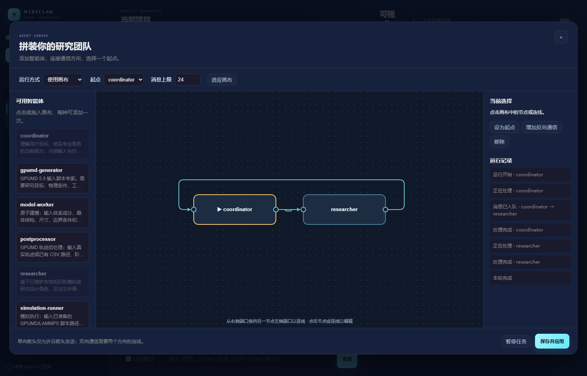

# 智能体画布

画布使用本地部署的 AntV X6；执行和消息调度由 MiniClaw 自己完成，没有引入 LangGraph。

## 使用

1. 重启 MiniClaw，进入项目，点击聊天区上方的「智能体画布」。
2. 点击或拖入需要的角色。角色来自当前 `AgentCatalog`，已有六个研究角色和新增的 `skill-builder` 可直接使用；`profiles/jail` 不在目录扫描范围内。每种角色最多放置一个节点。
3. 从节点右侧端口拖到另一节点左侧端口，创建一条有向连线。点击连线后选择「增加反向通信」可组成双向通信。
4. 在下拉框或节点操作中设置起点，设置单轮消息上限，保存并应用。
5. 回到项目对话发送任务。用户消息首先交给起点角色；打开画布可以查看消息投递、节点执行和结束状态。

一个节点即可单独运行 researcher 或其他角色，不要求存在 coordinator。选择「默认智能体」并保存可恢复 `multi_agent.default_profile` 的原有行为。运行中画布锁定，可先暂停项目，再修改配置；恢复项目后发送新消息开始下一轮。

## 通信和结果

- `A → B` 允许 A 调用本轮专属的 `message_agent(target, message)`，将消息入队给 B。连线本身不会自动启动 B。
- 每个节点执行完当前轮次后，调度器从 FIFO 队列取出下一条消息并激活接收方。第一版按队列顺序执行，不并行运行节点。
- B 回复 A 需要 `B → A` 连线和显式消息调用。最终文本回复只展示给用户，不会隐式沿反向边返回。
- 工具立即返回 `queued` 收据，不返回接收方结果。因此发送方应结束当前轮次，不能用轮询或等待占住队列。
- 所有节点的最终文本按执行顺序、带角色名称展示。发送方的交接说明可能出现在接收方的研究结果之前。第一版没有自动增加额外的总结角色。
- 默认最多接受 24 条智能体间消息，可设为 1–2000；用户的起始消息不占此额度。额度耗尽后拒绝新消息，继续处理已入队消息，最终记录 `limit_reached`。节点自身仍受工具轮数、角色超时及整轮任务超时限制。

## 权限与会话

- 客户端只提交节点名称、位置、方向、入口和消息额度。后端重新解析当前角色目录，检查重复节点、未知角色、无效边和不可达节点。
- 角色原有的工具和 Skill 白名单继续由共享 Agent 执行器校验。`message_agent` 是运行时注入的局部通信能力，不注册到全局工具表，也不修改角色 YAML。
- 画布模式会隐藏并拦截现有带 `coordination` 或 `communication` 标签的工具，避免通过旧委派入口或外部发消息工具绕过当前拓扑。工具参数不能覆盖运行时提供的权限上下文。
- 图权限控制的是框架的智能体通信入口；它不构成操作系统沙箱。角色已有的 shell、文件和网络权限仍按原有机制处理。
- 每个项目的公开对话保存用户请求和带角色名称的结果；每个节点拥有独立的 `agent_graph` 子会话，不向其他节点共享完整会话历史。消息发出方负责显式交接所需上下文与产物路径。
- 同一项目、同一拓扑中的节点历史会跨用户轮次保留。切换拓扑使用不同的会话命名空间；只移动节点不会重置节点历史。不同项目的节点会话隔离。
- 配置保存在根会话 `metadata.agent_graph`；最近一次运行的图快照、事件和输出保存在 `metadata.last_graph_run`，内部回调不会序列化。配置在请求接受时取快照。
- 暂停或超时会取消当前节点并丢弃待投递队列，不自动重放已经执行过的工作。重启后可以恢复画布配置和最近记录；运行中的内存队列不会断点续跑，记录会显示为中断。
- 画布模式第一版暂不叠加「计划模式」；可退出画布模式后使用原来的规划能力。已有的计划任务执行入口会通过同一个图运行时读取项目配置。

## 代码入口与验证

- `miniclaw/agents/graph.py`：图校验、消息能力、队列和节点会话。
- `miniclaw/channels/web/agent_graph_routes.py`：角色列表及配置保存。
- `miniclaw/channels/web/static/agent-graph.js`：画布编辑与运行事件展示。
- `tests/test_agent_graph.py`：使用确定性模型、真实 Agent 循环验证通信和权限，不调用在线模型或提交模拟。

运行后端验证：`python -m pytest tests/test_agent_graph.py -q`。

## 项目临时 Skill

当原角色已有工具和 Skill 不足以完成职责范围内的工作时，可以把 `skill-builder` 加入画布，并与请求者双向连接。请求者必须已有 `read_skill` 权限；执行型 Skill 还要求其原本拥有 `execute`。不会自动补齐缺失工具权限。

框架只为满足条件的节点注入项目控制接口：请求者使用 `request_skill(objective, acceptance)`，builder 用 `list_skill_requests` 读取契约并在返回的 `draft_dir` 中开发，然后使用 `publish_skill(request_id)` 验证和发布。这些是画布运行时接口，不注册到全局工具管理器；生成的实现始终保留在 Skill 包中。

发布会检查元数据、工具要求、路径、Python 语法与包大小，并实际运行包内 `unittest`。含 Python 实现时必须至少有一个真正执行且成功的测试；失败、超时或取消均不会启用该候选包。纯说明包可只做结构校验，记录明确区分 `structure_only` 与 `unittest_passed`。测试是否覆盖物理假设、单位和真实输入仍需要开发者与研究角色判断，不能把单元测试通过当作科学结论正确。

发布成功后，框架将带内容哈希的固定版本挂载给原请求者，并沿反向连线发送恢复消息。下一次激活时，请求者会在提示词中看到该 Skill，通过已有 `read_skill` 加载，再用原有工具继续任务。不会修改 `agent.yaml`，也不会把新函数硬编码进 `miniclaw/tools`。

画布右侧「临时 Skills」显示挂载目标、名称、版本以及待构建/验证失败状态。空闲时可点击「撤下」；任务运行时先暂停。智能体也可用 `revoke_skill(name)` 撤下自己的包。撤下会取消发现与 `read_skill` 加载，不删除历史版本，也不构成操作系统层面的文件访问撤销。

数据保存在项目工作区的 `.miniclaw/skill-workbench/`：`requests/` 保存草稿，`releases/<hash>/` 保存发布快照，`index.json` 保存请求、验证记录与角色挂载。包内容被改动、工具权限被收回或被同名全局 Skill 覆盖时，临时包会停止可用。同名升级要求版本号递增，失败的升级保留旧的有效绑定；不同项目与不同角色的可用 Skill 清单隔离。

builder 只有明确列出的读写工具与 `build-project-skill`，共享执行器限制其写入开放请求的草稿目录。Python 测试在临时工作目录中启动独立进程，不接收模型凭证，默认超时 30 秒；这不是操作系统沙箱。第一版按标准库或现成依赖开发，不自动安装软件、不启动模拟，也不自动向其他项目推广。

重启 MiniClaw 后才会启用新加入的后端流程。旧的默认 coordinator 模式不自动发起 Skill 开发。已挂载的 Skill 可在该项目后续的同角色调用中使用，持续到撤下或不再满足校验条件。

验证：`python -m pytest tests/test_project_skills.py tests/test_agent_canvas_browser.py -q`。浏览器测试需要 Playwright Chromium；缺少时跳过。端到端测例使用确定性模型和隔离的测试角色，验证了申请、文件生成、实际测试、挂载、恢复、加载和脚本执行，不调用在线模型或提交 MD。
