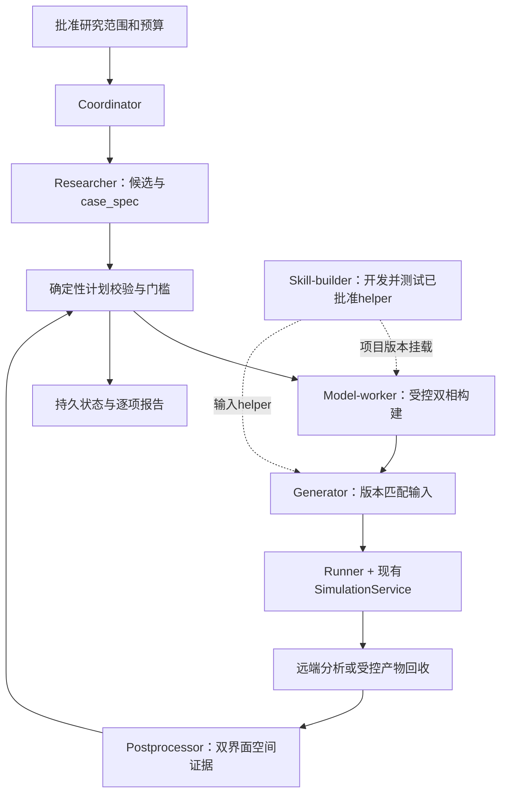

# 固态两相竞争自动化方案（待审阅，2026-10-24）

**建议首例：本地 UNEP-v1 主势，纯 Ti 的 α-HCP / β-BCC 双相平板，优先尝试 Mao 取向，观察 HCP 从既有界面吞并 BCC。**

这是依据现有资产与一手资料确定的优先候选，不是已经跑通的模拟结果。本阶段只调研、核验文件和设计方案；未修改源代码、现有 agent.yaml、SYSTEM.md 或 Skill，未配置服务器、未启动 MD。

配套审阅文件：

- [工具与状态契约](./工具与状态契约.md)：现有能力、新增能力、调用约定、验收和实施顺序。
- [提示词草案](./提示词草案.md)：共享规则、七个现有角色的分工及按需实验配方；均未启用。
- [势函数清单](./势函数清单.json)：本地路径、文件头、完整 SHA-256、重复权重和来源核验。

## 1. 已确认的目标

- 同一周期盒内放置两种晶相，观察两相界面迁移。
- 优先成功率，元素和相变类型不限；Fe FCC/BCC 是例子，不是必须条件。
- 第一阶段先可重复观察一相吞并另一相，再扩展平衡转变温度。
- 后续服务器资源充足，但还未配置。本次不接入服务器。
- 方案先供用户审阅，批准后才实施工具、提示词及试验。

“容易”在这里指有明确模型来源、合理相竞争窗口、可构造且有迁移先例的界面，以及可验证的分析方法。当前没有在本机或服务器做候选对比测试，无法给出实测成功率。

## 2. 本地势库检查与选材结论

给定目录下识别到 5 类资产、15 个势权重文件、13 个不同 SHA-256。UNEP-v1 主文件与 ensemble 的 nep-44-80 完全相同；PdCuNiP 的顶层 nep4.txt 与训练包中的发布权重相同，不能将副本计为独立模型。

| 候选及可用权重 | 已核实的依据 | 首例定位 |
|---|---|---|
| **Ti HCP/BCC＋UNEP-v1** | 同字节权重有纯 Ti 两相自由能官方教程；有 Ti 预置 HCP/BCC 界面迁移论文，但采用另一势 | **主选，有条件进入试验** |
| Zr HCP/BCC＋UNEP-v1 | 元素支持，材料存在该相变；未找到与本地同权重的同等级纯 Zr 共存/自由能验证 | 后备，先补模型级校准 |
| Fe FCC/BCC＋NEP89 | 权重身份、元素支持明确；未找到该权重两相界面或相间自由能验证 | 暂不优先，磁性/有限温度校准负担更大 |
| Co HCP/FCC＋NEP89 | Co 有专用 EAM 两相研究先例，不能转移到本地 NEP89 | 研究备选，当前证据不足 |
| PbTe 高压结构竞争＋TePb/nep.txt | 匹配官方历史 PbTe 示例；高压有 Pnma 中间相，权重相变覆盖尚未建立 | 不作为首例 |
| PdCuNiP、W | 前者资产偏多组分玻璃研究；后者未找到这两个具体权重的简单双固相共存验证 | 不作为首例 |

固液共存可以作为未来的流程阳性对照，但它不完成用户这次“两种晶相竞争”的目标。

### 2.1 Ti 主选的关键证据链

1. 本地文件：`C:/Users/35059/Desktop/MDAgent/机器学习势/NEP/16元/UNEP-v1-main.txt`。
2. 该文件共 1,127,108 字节，SHA-256：
   `8f97c30cc366c30e687a8672bd8d76e624a16caf4337b1277a44aa166c5bceb4`。
3. 官方 Calorine 教程数据包中的 `free_energy_calculations/nep-unep-v1.txt` 与其 SHA-256 相同；MD5 也与作者 UNEP-v1 发布记录吻合。[S1][S2]
4. 教程明确用此模型研究纯 Ti 的 HCP/BCC 自由能，报告零压交点约 **1140 K**。[S1]
5. 这是同权重的体相热力学锚点，尚不证明同权重下某个界面的迁移速度或形态。Ti 界面取向的选择另有独立方法依据。[S4]

UNEP-v1 的 16 元素列表不含 Fe 或 Co；做 Fe/Co 必须使用另一模型，不能把 UNEP-v1 的验证当成 NEP89 的验证。[S2][S6]

### 2.2 明确保留的限制

- 原 UNEP-v1 论文中的 TiZrVMo、TiZrVMoTa 转变案例使用 MCMD，不能作为纯 Ti/Zr 普通 MD 界面迁移的直接证据。[S3]
- 同模型补充表 S4 给出的 Ti 熔点为 1610 K，对照实验为 1941 K；Zr 为 1860/2128 K。这个模型并非所有相变温度都准确，实验温度不能直接作模型参数。[S3]
- Fe 的有限温度 FCC/BCC 稳定性涉及磁与晶格贡献；普通构型势对元素的支持，不能证明已包含正确的磁熵。NEP89 的 Fe 缺陷测试也不等于界面相变验证。[S6][S7]
- PbTe 的已知高压路径包含中间 Pnma 相，直接做 B1/B2 二相竞争会遗漏竞争相；本地模型的精确出处已核实，训练/验证覆盖仍需另查。[S8][S9]

## 3. 首例的具体实验设计

所有下述数值均为**候选设计**，除非另标 FILE/LIT/CALC。它们需经过批准后实际校准，不能被报告为已验证条件。

### 3.1 初始目标与温度

主试验先选 **1050 K、接近零外压**，观察 HCP 吞并 BCC；1100 K 作为较小驱动力候选。1000 K 仅在对应单相对照合格且预注册预算允许时补查。与约 1140 K 的体相锚点相比，这些点位于预期 HCP 更有利的一侧，但界面应变、约束与有限尺寸会影响实际驱动力。

不把 1140 K 当成首轮必须复现的精确温度，不在预期驱动力很小时盲目延长到无限时间。1200 K 的反向竞争与精确平衡温度列入第二阶段，不是第一阶段的通过条件。

### 3.2 首选 Mao 取向与界面

2026 年 Ti 界面研究的平面迁移先例采用 Mao 取向；其 Burgers 模型出现不同的突起生长形态。该研究使用 Mendelev EAM，其温度、速度和晶格常数不移植到 UNEP-v1。[S4]

| 取向 | 界面平面 | 共同面内方向 |
|---|---|---|
| **Mao，主选** | `(0001)HCP ∥ (110)BCC` | `[2 −1 −1 0]HCP ∥ [001]BCC` |
| Burgers，比较支线 | `(0001)HCP ∥ (110)BCC` | `[1 −2 1 0]HCP ∥ [1 −1 1]BCC` |

建模以“共同平面法向＋共同面内方向”确定两个旋转矩阵，再从叉积生成第三轴，检查正交性和右手性。不能机械复制论文有向轴符号，更不能只凭“差 5.26°”猜旋转矩阵。

全周期层状盒必然有两处相界面。两处界面都必须检查间距、接缝、终止面、残余应变和初始位置，并在生产阶段全部释放。不能只处理盒内中间接缝而忽略周期边界处的第二处接缝。

### 3.3 已计算的低错配起点

由官方同权重教程的热膨胀拟合，在 1050 K 计算得到：[S1]

| 参考量 | CALC 值 | 使用限制 |
|---|---:|---|
| BCC a | 3.290739 Å | 来自教程拟合，正式参考由本次热化复验 |
| HCP a | 2.957214 Å | 同上 |
| HCP c | 4.710493 Å | 同上 |
| x：`10√3 aHCP` / `11√2 aBCC` | 51.22045 / 51.19189 Å | 对称相对错配约 +0.0558% |
| y：`10aHCP` / `9aBCC` | 29.57214 / 29.61665 Å | 对称相对错配约 −0.1504% |

这是整数匹配方案，不是已经生成并验收的双相模型。建议先用约 **5.1×3.0×30 nm、约 2.5 万原子**的小模型做完整管线检查；正式重复可将面内两个方向倍增至约 **10.2×5.9×30 nm、约 10 万原子**。实际原子数由明确的晶胞、层厚与终止面计算并记录，不硬凑目标数。

每相法向厚度初始约 15 nm。面内公共长度与两相应变分配必须写进 manifest；优先使用实测有限温度参考、低错配方案，不静默强拉某一相到另一相晶格。后续加倍法向厚度、增大横截面的检查分别进行。

### 3.4 温压控制与准备阶段

- 单相参考：在同一势、对应温度、零目标法向压力下获得晶格、结构分类基线、能量/体积与应力统计，同时检查剪切应力。BCC 的低温或 0 K 失稳不能简单等同于高温不存在；有限温度保形检查单独进行。
- 双相准备：先检查重叠和两处接缝，必要的短时约束只用于建立初态；所有约束区域和释放时刻留痕。避免无约束 0 K 最小化把整个 β 相提前消灭。
- **主发现支线**：候选为三向周期、Pxx/Pyy/Pzz 目标为零、三条正交盒长独立变化且盒倾斜固定的 NPT，记录全部六个应力分量。它不能保证剪切应力为零，主支线同样要排查剪切约束钉扎。该设计受到文献全方向松弛做法启发，但具体自由度、控温/控压算法及数值是我们的设计，不能声称复刻原文未报告的细节。[S4]
- **约束对照支线**：固定公共面内尺寸、仅法向调压，用来分辨失配与盒子松弛影响。它代表受约束条件，不等于无应力体相共存；若不迁移，要检查应力与剪切钉扎，不能直接否定势。[S5]
- GPUMD 语法由目标服务器的固定版本确认。当前在线文档为 v5.9.1，项目提示词固定 5.5，不能默认为完全兼容。官方文档有关闭指定盒分量更新的约定，但上线前需验证目标版本和实际输出。[S10]

初始时间步长候选 1 fs；用一组 0.5 fs 对照核对数值稳健性。控温、控压物理时间可从 100 fs、1000 fs 作为候选开始，必须记录算法与换算后的 GPUMD 参数，不将这些数值称作 Ti 材料常数。

### 3.5 输出与数据预算

- thermo 候选每 0.1 ps，轨迹候选每 0.5 ps；在 1 fs 下分别对应 100、500 步。依据实测迁移速度和分辨率再在预授权范围内调整，不丢失时间轴。
- 原始轨迹保留坐标、晶胞、真实时间与身份对应。默认不输出本任务不需要的逐原子力、速度和额外能量列；总能量与应力有明确来源。
- 约 10 万原子的长轨迹可能达到每 case 数 GB。优先在服务器流式分析，只回收摘要、空间剖面、图、代表帧和校验清单。完整轨迹继续保存并可追溯，不进入 LLM 上下文。
- 所有阶段输出分目录，保存 restart、输入哈希、程序版本、运行 ID、随机种子和采样定义。试跑与生产数据隔离。

## 4. 有预算的执行顺序

| 阶段 | 必需工作 | 阶段门槛 |
|---|---|---|
| G0 资产/后端 | 核实势哈希、服务器 GPUMD/调度器/分析依赖、实际小任务通信闭环 | 配置存在不等于后端可用；网络、GPU、提交/查询/取回都通过 |
| G1 单相参考 | 1050/1100 K 的 HCP、BCC 对照，必要时补 1000 K | 两相在观察窗有可识别核心；压力/温度和数值稳定；分类基线可区分 |
| G2 双相初态 | Mao 优先，检查两接缝、应变、近邻、核心区、约束释放 | 初态有效；生产开始前仍有两相核心，两个界面可定位 |
| G3 短程发现 | 合格温度下先做 50 ps，按预注册条件延至 200 ps；必要时比较 Burgers/约束对照 | 分清界面推进、整体失稳、钉扎与分类不足；不因未移动无限追加 |
| G4 重复 | 固定有效构型/物理条件，三个预先固定速度种子，候选 200–500 ps，单例最多 1 ns | 相同方向可重复；使用实际空间界面证据 |
| G5 尺寸/数值检查 | 法向加厚、横截面增大分别检查；补 dt 对照 | 排除明显的双界面相互作用、有限横截面和积分伪影 |
| G6 汇报 | 每 case 和每项交付保持真实状态，输出关键动画与证据表 | 不把运行成功、相比例变化或准备阶段变化等同于目标完成 |

首轮建议上限：**18 个独立物理 case、4 个管线/语法短试跑；累计 MD 物理时间不超过 6 ns，单 case 最多 1 ns，最大约 20 万原子。** 这是审批预算建议，不是必须用满的计算量。先做 G0–G3，获得有效条件后才扩大重复与尺寸检查；实际墙钟预算经首轮服务器测速再确定。

在预算内未观察到有效迁移时，交付其原因类别与证据。若全部候选均未通过 G1/G2，结束本轮并讨论 Zr 或其他势；不能自动改势、加压、升到熔化或删除不成功样本。

## 5. 第一阶段如何判成功

第一阶段不要求测得平衡温度。建议预注册如下验收层次，阈值应在正式生产前固定：

1. **管线通过**：模型、提交、续跑、数据取回、空间分析可重复完成；这不等于材料目标成功。
2. **界面推进确认**：两相核心区仍可辨认；有从原相界面出发的连续前沿运动，位移超过分类/定位噪声与空间分箱分辨率；相层厚度变化与前沿运动一致。
3. **可重复吞并演示**：三份独立速度种子同向推进，至少两份在预算内达到预注册的近吞并标准。建议固定指标为“由空间前沿/连通相域确定的 HCP 相层物理体积 ÷ 当帧全盒物理体积”，达到约 90%，并有时空前沿证据；分母不能排除 Other 或未分类区，不能换成 HCP 核心原子占比。不确定区域过大时不可判定。其余未完全耗尽也保留，不筛掉。90% 是演示阈值，不是相变理论常数。
4. **控制检查**：在关键时间窗，另一相核心没有在整个体内同时塌陷；没有把高温无序/局部熔化、盒子伸缩、整体漂移或界面越过周期边界当成迁移；尺寸与 dt 对照不改变主要解释。

分析必须包括：

- 逐原子 HCP/BCC/FCC/Other 与分类质量；必要时核查 ω 等竞争结构。PTM 的 Other 不能直接解释为液体、非晶或 ω；未能排除竞争相时输出不可判定。
- 法向空间结构剖面随时间的热图。
- 两处界面分别的坐标、连续展开位移、界面宽度与横向粗糙度。
- 相核心连通区/体积或厚度；两相的局部位移与无序信号。
- 拟合窗口内的迁移速度、方向与时间相关性处理后的不确定度；避开初态调整、最终耗尽和两界面碰撞区间。突起明显时报告局部前沿分布，不强行拟合一条平面速度。
- 六个应力分量与盒形变化，以及真实 thermo/程序退出状态。

“无迁移”是合法观察；可能对应驱动力小、钉扎、约束、样本不足或分类困难。“全盒同时变相”也可能是真实相变，但不满足此次预置界面迁移目标。

## 6. 对当前多智能体项目的改造定位

保持当前七个顶层角色，不先增加更多对话角色。当前 researcher 与 phase-transition-design 已具备来源分级、参数闭合；这部分可以扩展。AgentGraph 适合角色路由，RunStore 适合作业状态，二者之间还需要一个持久的实验 case 层。

当前重点缺口不是再增加一段“请认真分析相变”的提示词，而是四项能力：

1. 受控双相建模和两界面几何验收。
2. 双界面空间跟踪、位移/速度与竞争解释排除。
3. 服务器结果回收或服务器同版分析闭环。
4. 可恢复的实验级状态与有预算的科学判据。

当前 postprocessor 没有 execute/read_skill，不能通过挂载任意 Python Skill 自动补齐空间分析。建议新增专用分析工具，保持其无通用执行权限；model-worker 则可通过现有项目 Skill 机制使用经过测试的建模 helper。具体方案见配套契约。

## 7. 第二阶段才做的工作

- 在经验证的几何、边界与势下找两侧驱动力，增加重复与更大尺寸，并用带不确定度的速度符号/自由能分析确定条件相关的竞争区间。
- 若要声称体相零压平衡温度，分开处理共格应变、受约束边界、界面钉扎和热力学自由能；不能把一次“界面停住”的温度直接称为体相 Tc。
- TI/可逆缩放可作为独立热力学校验，但要先确认服务器版本支持、参考路径与收敛。首轮不为复现教程而自动加入整套自由能计算。
- Zr 仅在同势相稳定性和窗口校准后启动独立方案；Fe 若继续，应单独建立 NEP89 的两相适用性证据。

## 8. 主要一手来源与实际阅读范围

- **[S1] Calorine 官方自由能教程**：[网页](https://calorine.materialsmodeling.org/dev/get_started/free_energy_calculations.html)、[数据集 v9](https://zenodo.org/records/22810600)。已读 Application case、温度依赖、热膨胀拟合及相关计算说明；核对包内模型哈希。约 1140 K 是该教程的模型结果，非本次模拟实测。
- **[S2] UNEP-v1 作者发布模型**：[Zenodo v2](https://zenodo.org/records/11533864)。核对 UNEP-v1-main.txt 的 MD5 与教程模型；本地对应主势与 nep-44-80 为相同字节。
- **[S3] Song 等，General-purpose machine-learned potential for 16 elemental metals and their alloys**：[Nature Communications](https://doi.org/10.1038/s41467-024-54554-x)、[作者全文及补充资料](https://materialsmodeling.org/assets/publications/SonZhaLiu24.pdf)。已核对元素、MCMD 合金案例、熔点验证与 SI Table S4。
- **[S4] Sugiura、Matsunaka，2026，Molecular Dynamics Simulations of Phase Transformation Behavior at BCC-HCP Interfaces in Titanium**：[原文](https://doi.org/10.2472/jsms.2025.00099)、[PDF](https://www.jstage.jst.go.jp/article/jsms/75/2/75_2025.00099/_pdf/-char/en)。已读全文并看图核对 p.124 §2/Fig.2 的取向符号、结果中的迁移形态。原文明确 EAM、全方向 PBC/NPT 松弛、最长 200 ps；未完整报告控压算法/剪切自由度等，方案未补造。
- **[S5] Wang 等，2023，Coherent and semicoherent α/β interfaces in titanium**：[原文](https://doi.org/10.1038/s41524-023-01170-w)、[作者预印本](https://arxiv.org/abs/2311.02897)。已核对相稳定性先行、共格应变、台阶/错配位错与迁移。该文采用 Deep Potential，其温度和数值不归给 UNEP-v1。
- **[S6] NEP89 作者模型和论文**：[v5.0 权重](https://github.com/brucefan1983/GPUMD/blob/v5.0/potentials/nep/nep89_20250409/nep89_20250409.txt)、[作者论文](https://arxiv.org/html/2504.21286v3)。权重 SHA 与本地相同；已核对 Fe 缺陷演示、应用范围与代码发布信息，未找到该权重 Fe FCC/BCC 界面验证。
- **[S7] Fe 磁/晶格相稳定性研究**：[ASD-AIMD 原始研究](https://arxiv.org/abs/2210.14718)。用于说明额外物理自由度的校准需求，不把其他模型的温度转给 NEP89。
- **[S8] 本地 TePb 的精确来源**：[GPUMD v5.0 prediction 权重](https://github.com/brucefan1983/GPUMD/blob/v5.0/examples/nep_prediction/nep.txt)。核对同 SHA；不能与当前 master 的另一权重混用。
- **[S9] PbTe 高压中间结构实验**：[Physical Review B 71, 224116](https://doi.org/10.1103/PhysRevB.71.224116)。用于说明 B1/Pnma/B2 竞争与分类复杂度，不声称本地权重已覆盖。
- **[S10] GPUMD 官方 ensemble 文档**：[在线文档](https://gpumd.org/gpumd/input_parameters/ensemble_standard.html)。本次页面标记 v5.9.1；正式输入须按目标版本另行校验。

本次取得的论文和教程包仅作为研究缓存保存于临时目录，未挂载为项目 Skill，也未启用任何草案。
